

# 引言

## 为什么我们现在仍然要学习Vim

在学习 Vim 之前,我们先考虑一个看起来显然的问题:

> 什么是一个文本编辑器?

作为程序员, 我们每天其实都在和 "文本" 打交道。源代码是文本, 配置文件是文本, Shell 脚本是文本, Markdown 文档也是文本；

所谓文本编辑器 (Text Editor), 就是一个用来查看和修改纯文本文件的程序。 你大概已经使用过很多文本编辑器了。 VS Code, Vim, Neovim, Notepad, 乃至很多 IDE, 其核心都包含一个文本编辑器。

<figure>

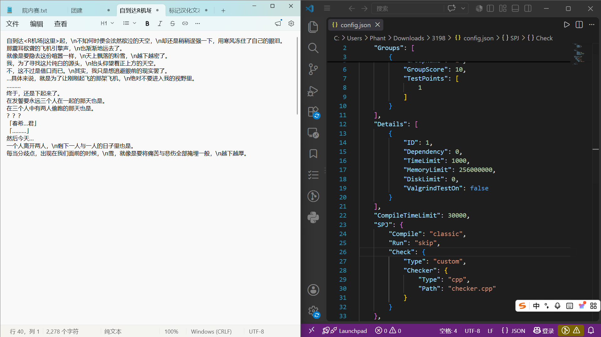 

</figure>

那 Vim 作为一个基于命令行的文本编辑器,它的最主要的优势源于其被广泛认可的设计哲学：

- 编程时, 你大部分时间花在阅读和编辑上, 而非书写. 正因如此,

- Vim 是一款模态编辑器: 它针对插入文本和操作文本设有不同的模式.

- Vim 是可编程的 (支持 Vimscript, 也支持 Python 等其他语言), 而且 Vim 的界面本身也是一种编程语言; 按键 (带有助记名称) 就是命令, 而这些命令具有可组合性.

- Vim 避免使用鼠标, 因为鼠标操作太慢;

- Vim 甚至避免使用方向键, 因为那也需要过多的手部移动. 最终的结果是, 这款编辑器能够跟上你思考的速度.

<figure>

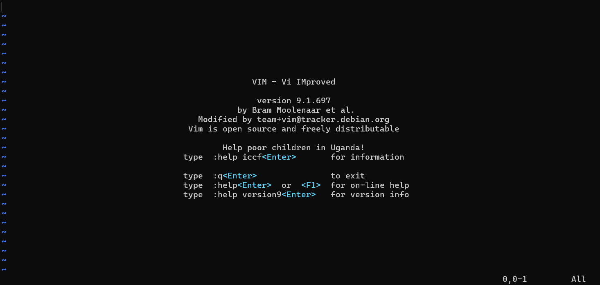 

</figure>

所以我们来学习如何启动和使用 Vim .

## 第一次使用Vim

### Vim的启动

启动 Vim 的命令如下:

vim file.txt

在你的Linux系统中键入这一行，现在 Vim 开始编辑一个名为 file.txt 的文件了。由于这是一个新建文件，你会得到一个空的窗口。屏幕看起来会像下面这样:

<figure>

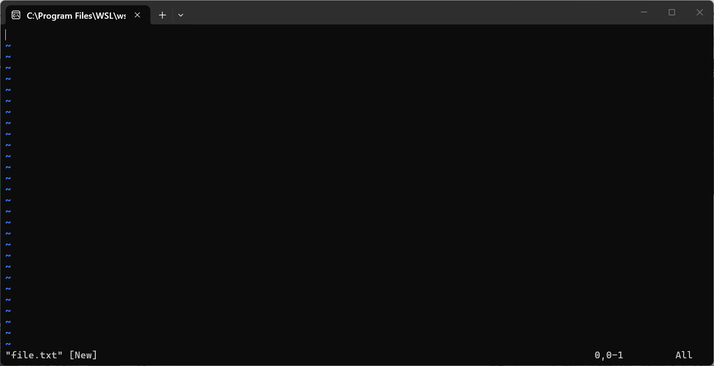 

</figure>

以波纹线 ()̃ 开头的行表示该行在文件中不存在。换句话说，如果 Vim 打开的文件不能充满这个显示的屏幕，它就会显示以波纹线开头的行。在屏幕的底部，有一个消息行指示文件名为 file.txt 并且说明这是一个新建的文件。这行信息是临时的，新的信息可以覆盖它。

### 模式与基础操作

#### 插入文本

Vim 是一个多模式的编辑器。就是说，在不同模式下，编辑器的响应是不同的。在普通模式下，你敲入的字符只是命令；而在插入模式，你敲入的字符就成为插入的文本了。

当你刚刚进入 Vim，它处在 Normal Mode (普通模式, 下文不再重复)。通过敲入 "i" 命令 (i 是插入 (Insert) 的缩写) 可以启动 Insert Mode (插入模式, 下文不再重复)，这样你就可以输入文字了，这些文字将被插入到文件中。不用 担心输错了，你随后还能够修正它。要输入下文的程序员打油诗，你可以这样敲:

iA very intelligent turtle

Found programming UNIX a hurdle

输入 "turtle" 后，按回车开始一个新行。直到输入全部文字。这时, Vim 会在窗口的底部显示 –INSERT– (中文模式显示的是 –插入–)，这表示你在 Insert Mode。

<figure>

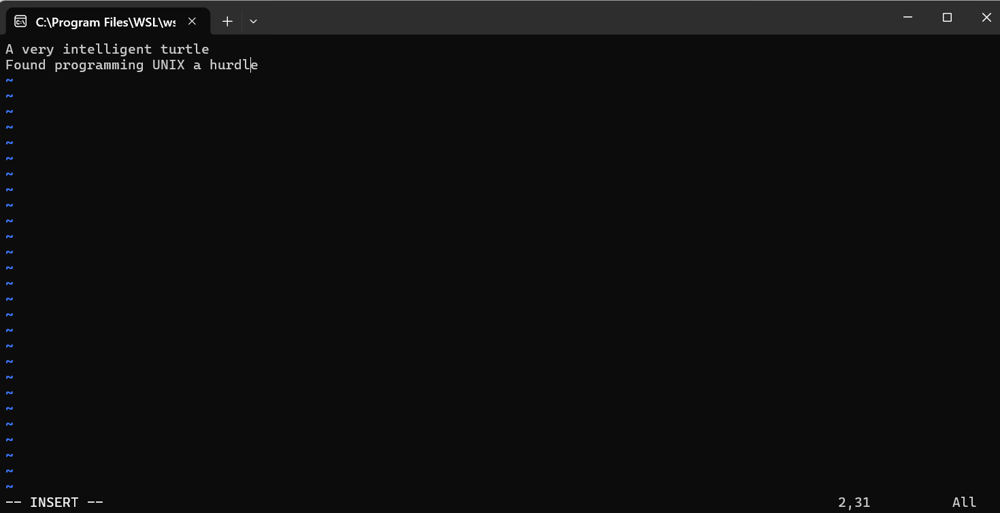 

</figure>

最后，你输入 Esc 键退出 Insert Mode 而回到 Normal Mode ,同时左下角的"–INSERT"也消失了，现在在你的 Vim 窗口中就有两行文字了:

<figure>

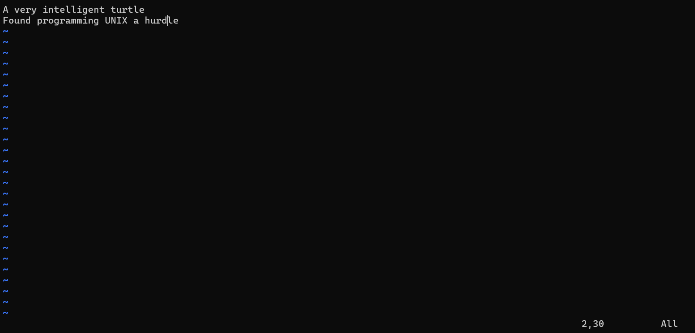 

</figure>

#### 模式的查看

在 Vim 中当然提供了不止一种模式，除去上文所提到的 Normal Mode 和 Insert Mode, 还有 Visual Mode, Replace Mode 和 Command Mode。他们分别起到选择文本、替换文本、键入命令的特殊作用。在 Vim 的界面中，默认左下角会显示当前所处的模式，无显示即为 Normal Mode。

同时，在不同的操作模式下，同样的按键会产生不同的效果。

例如, 字母 x 在 Insert Mode 下只是输入字符 x , 但在 Normal Mode 下会删除光标所在的字符, 而在 Visual Mode 下则会删除当前选中的内容, 这些具体的差异我们将会在后面的行文中具体展现.

#### 模式的切换

按 \<ESC\> (退出键) 可以从任何模式返回到 Normal Mode; 为此，因为其极其常用，可以考虑将 Caps Lock 键映射为 Escape, 或者用一个简单的按键序列为 \<ESC\> 创建替代映射方案.

从 Normal Mode 出发, 按 i 进入 Insert Mode , 按 R 进入 Replace Mode , 按 v 进入 Visual Mode , 按 V 进入 Visual Line Mode , 按 : 进入 Command Mode.

对于 Normal Mode 到 Insert Mode 的例子，这是日常应用中最常见的情形，比如:

- 在下⽅插⼊⼀⾏： o

- 在上⽅插⼊⼀⾏： O

- 在当前光标后插⼊： a

- 在当前光标前插⼊： i

- 在⾏尾插⼊： A

- 在⾏⾸插⼊： I

我们将常见情况整理成了一张图，大家可以体会一下:

<figure>

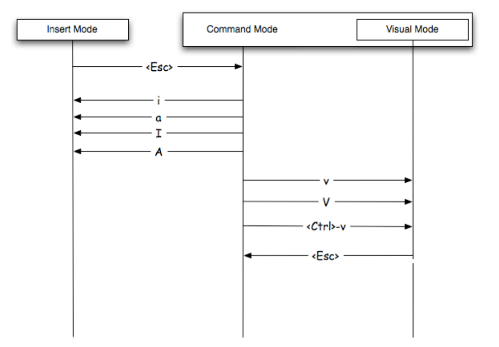 

</figure>

### 常见的编辑命令

#### 移动光标(hjkl)

回到普通模式后，你可以用 hjkl 代表 上下左右 来移动光标；这些命令看起来是随便选的。无论如何，谁听说过用 l 表示右的？但实际上，作这些选 择是有理由的: 移动光标是最常用的编辑器命令。而这些键位在你的右手本位。也就是说: 这种键位的设定使你可以用最快的速度执行移动操作 (特别是当你用十指输入的时候)。

#### 删除字符

要删除一个字符，把光标移到它上面然后输入 "x"。(这是对以前的打字机的一种回归，那时你通过在字符上输入 xxxx 删除它) 例如，把光标移到行首，然后输入xxxxxxx (七个x) 可以删除 "A very "。结果看起来这样:

<figure>

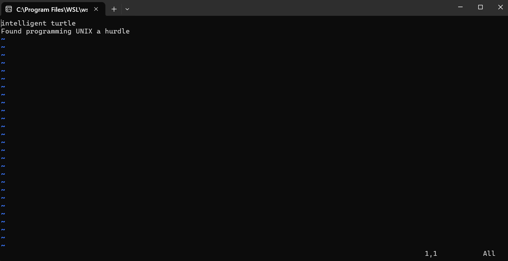 

</figure>

现在你可以输入新的字符了，例如，通过输入:

iA young \<Esc\>

这个命令启动一次插入操作 (那个 "i")，并插入 "A young"，然后退出插入模式 (最后 一个 \<Esc\>)。结果是:

<figure>

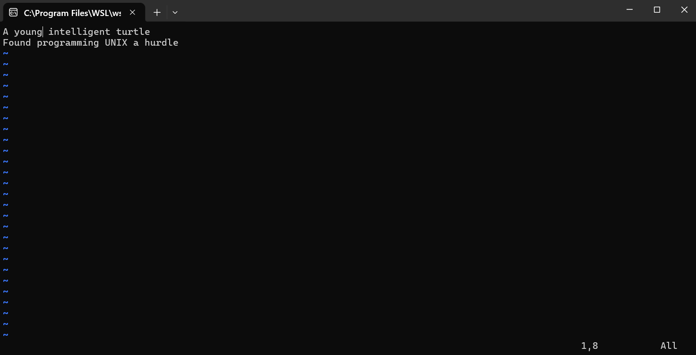 

</figure>

要删除一整行，使用 "dd" 命令，后一行会移上来填掉留下的空行:

<figure>

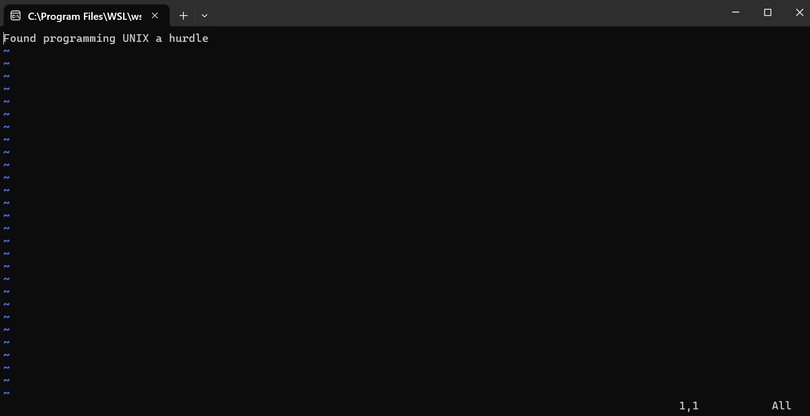 

</figure>

要删除一个换行符，或者称之为“合并行行为”，使用 "J" 命令； 以下面两行为例,把光标移到第一行，然后按 "J":

<figure>

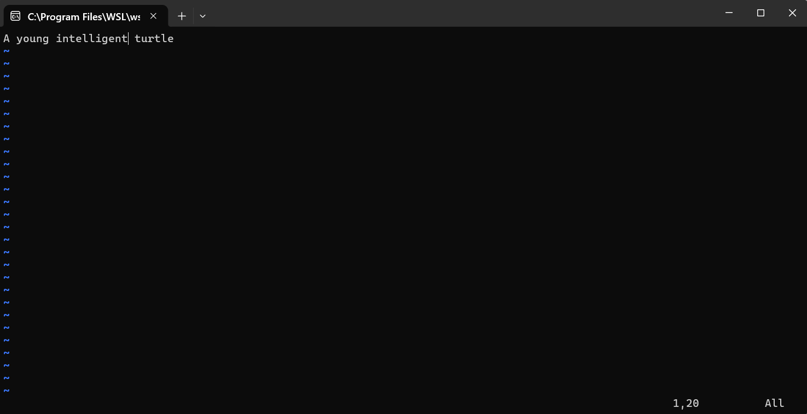 

</figure>

#### 撤销操作

编辑时难免会误删内容。与其重新输入，不如使用普通模式下的 `u` 命令，撤销最近一次编辑操作。例如，用 `dd` 删除一行后，再按 `u`，被删除的行就会恢复。

下面通过逐个删除字符的例子，观察撤销操作的过程。假设当前文本为：

           A young intelligent turtle

现在输入 `xxxxxxx` 删除 “A young”。结果如下：

           intelligent turtle

输入 `u` 撤销最后一个删除操作。该删除操作删除了字符 `g`，所以撤销命令恢复这个字符：

           g intelligent turtle

继续按 `u`，文本依次恢复为：

           ng intelligent turtle
           ung intelligent turtle
           oung intelligent turtle
           young intelligent turtle
           A young intelligent turtle

需要注意的是，连续按两次 `u` 并不会导致文本恢复原样，关于 `u` 的更多边界条件将在后文进一步介绍。

#### 重做操作

如果你撤销得太多，可以输入 `CTRL-R` (redo) 回退前一个撤销命令。换句话说，它撤销一个撤销。

接着上面的例子，当文本已经完全恢复后，连续按两次 `CTRL-R`，就会重新执行对字符 `A` 及其后空格的删除操作，得到：

           young intelligent turtle

除了逐次撤销，Vim 还提供了行撤销命令 `U`，用于撤销最近对当前行所做的所有改动。注意，大写的 `U` 与小写的 `u` 作用范围不同。

假设当前行为：

           A very intelligent turtle

删除 `very`：

           A intelligent turtle

再删除 `turtle`：

           A intelligent

此时按 `U`，整行恢复到修改前的状态：

           A very intelligent turtle

需要注意的是，`U` 本身也被视为一次修改。因此，再按 `u` 可以撤销这次行恢复操作，回到：

           A intelligent

随后按 `CTRL-R`，又可以重做这次行恢复操作。连续使用两次 `U`，也可以取消前一次 `U` 的效果。

初学时不必急于记住所有细节。先掌握最常用的一组操作即可：误操作时用 `u` 撤销，撤销过多时用 `CTRL-R` 重做。

### 寻求帮助

学习 Vim 不需要一次记住所有命令。遇到不熟悉的操作时，可以随时查阅内置帮助。

与网络搜索相比，内置帮助有两个直接的优势：一是主题命名遵循统一规则，便于精确查找；二是帮助文档通常与所安装的 Vim 版本配套，可以减少因版本差异带来的困惑。

输入以下命令，可以打开帮助首页：

           :help

如果已经知道要查找的主题，可以在命令后指定主题名称：

           :help {主题}

例如，以下命令分别用于查看 `x` 命令、删除操作和命令索引的帮助：

           :help x
           :help deleting
           :help index

在上文的案例中，我们已经见到了一些关于 Vim 使用的具体例子。关于命令的具体细节和边界条件，我们将在后文中详细介绍。笔者只是想借此一隅，来介绍 MiniVim 和真实 Vim 的关系，由此展现项目动机。

# MiniVim

## 项目初衷

> 一个面向大一学生的 C++17 课程项目: 从零实现一个可以在终端中运行的, 具有基本 Vim(version 9.1) 操作方式的文本编辑器.

完成项目后, 你应该能够:

1.  熟悉相对现代 C++ 的基本语法与 STL, 如 类, std::filesystem, std::optional, std::vector;(Basic)

2.  掌握基本的 **模块化设计** 思想, 将一个复杂问题拆分成若干职责明确, 相互协作的模块;

3.  理解 **封装** 的意义, 通过类的公开接口隐藏内部状态和实现细节;(Advanced, 你极有可能在重构代码的时候真正体会到以上两点)

4.  对 Vim 之类的文本编辑器的底层设计实现有新的了解.(Just For Fun)

## 项目架构

### 框架与目录结构

MiniVim 使用 C++17 ,希望实现一个行为基于Vim9.1的终端文本编辑器。项目为 Basic 部分提供了教学框架，帮助大家把文本存储、光标移动、命令解析和终端显示拆分为职责明确的模块。当然你也可以从零设计实现，只要满足项目规定的外部行为与评测要求；对于第一次写项目的同学，请优先沿用框架。

项目中的主要文件如下。

            MiniVim/
            |-- Makefile
            |-- *this file
            |-- src/
            |   |-- Types.hpp, Key.hpp, TextLayout.hpp
            |   |-- Buffer.hpp, Buffer.cpp
            |   |-- Window.hpp, Window.cpp
            |   |-- Command.hpp, Command.cpp
            |   |-- Renderer.hpp, Renderer.cpp
            |   |-- Editor.hpp, Editor.cpp
            |   |-- Terminal.hpp, Terminal.cpp
            |   `-- main.cpp
            |-- test/basic/
            |       |-- Note.md
            |       |-- 1.in ... 28.in
            |       `-- 1.ans ... 28.ans
            -- docs/images/key-processing-flow.png

**框**架中直接抛出"Not implemented"和有注释要求填写的地方都是你需要补全的函数

### src内各文件简要介绍

| **文件**               | **模块职责**                                  |
|:-----------------------|:----------------------------------------------|
| `Types.hpp`、`Key.hpp` | 定义了一些基本类型。                          |
| `TextLayout.hpp`       | 辅助函数头文件,帮助处理文本显示。             |
| `Buffer.hpp/.cpp`      | 按行保存文件内容, 处理底层的文本修改。        |
| `Window.hpp/.cpp`      | 作为视口，限制合法位置并确保光标可见。        |
| `Command.hpp/.cpp`     | 把 `NormalMode` 的按键解析为动作。            |
| `Renderer.hpp/.cpp`    | 根据Buffer,Window的状态生成一帧的完整字符串。 |
| `Editor.hpp/.cpp`      | 协调链接各模块成完整编辑器。                  |
| `Terminal.hpp/.cpp`    | 已提供的终端基础逻辑。                        |
| `main.cpp`             | 已提供的程序入口。                            |

对于这些文件更加具体的描述我们作为注释写在了这些文件里,请不要忽视这些注释

### 建议的阅读与实现顺序

阅读代码时,建议先分文件略读,了解各文件内接口;再从main函数中的run(),自顶向下过一遍一次按键流入的逻辑。

实现时建议分阶段推进：

1.  **基础数据** 从简单的部分开始, 完成按键辅助函数，实现 Buffer 来储存实际文件内容。

2.  **光标与解析** 实现 Window 的位置限制和移动，以及 NormalModeParser 的 Basic 单键解析。

3.  **画面生成** 实现 Renderer 的帧生成逻辑。

4.  **完整Basic** 实现 Editor, 此时可以在终端里尝试使用你的MiniVim,使用的过程本身就是一种debug。

5.  **Advanced** 此时你已经完全理解了框架,可以自己在框架之上修改来实现Advanced部分的功能了

### 项目的运作流程

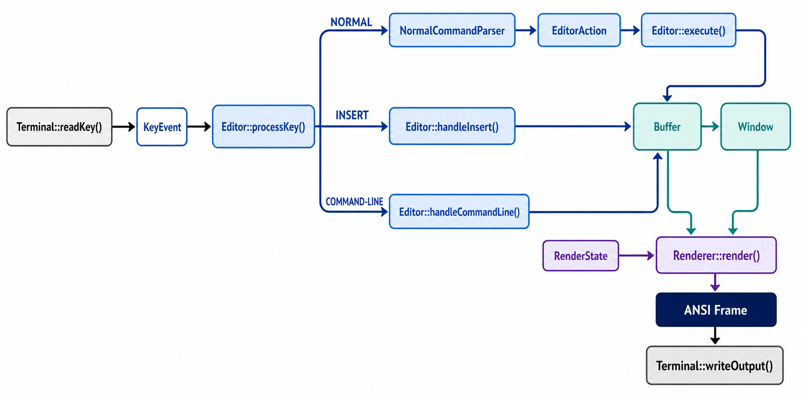

`Editor::ProcessKey()` 是按键分发唯一的入口。Basic 中只有 Normal 模式先经过 `NormalModeParser::``Feed()` 生成 `EditorAction`，再由 `Editor::Execute()` 执行动作。Insert 与 Command-line 分别交给 `HandleInsert()` 和 `HandleCommandLine()`。

## 项目开发常识

### 编译与运行

下面以 Ubuntu 24.04 环境为例：

        sudo apt install build-essential
        g++ --version
        make --version

所有未另行说明的项目命令均在 MiniVim 根目录执行。

**当前项目的 Makefile 默认设置是 `TARGET := MiniVim`， 但是提交的时候ACMOJ只能识别叫做"code"的二进制,所以如果提交,你需要改成TARGET := code** 接下来的讲解我们默认名字为MiniVim,你可以使用以下命令编译并运行：

        make    //编译
        ./MiniVim   //在当前根目录内运行MiniVim
        ./MiniVim example.txt
        ./MiniVim "notes with spaces.txt"

程序只接收零个或一个文件路径。没有路径时创建无名缓冲区；有路径时由 Buffer 按规则加载或初始化对应内容。

当你修改了src下文件的任何代码,你都需要重新编译生成新的二进制

请执行:

        make clean //清除当前的编译产物
        make //重新编译

### Basic部分的Debug

完成 Basic 后，可按以下顺序进行一次人工检查：

1.  启动程序, 就像使用一个真正的文本编辑器一样自由使用你已经实现过的Basic功能。

如果你对于你的MiniVim在这些操作都很满意,那你就应该有自信认为你的程序正确 在你有自信的情况下,可以使用我们下发的basic部分测试点进行最终确认,我们保证这些测试点和ACMOJ上的Basic测试点要求是完全相同的

## 项目测评

下发测试  
Basic部分的全部测试点,具体使用说明在test/basic/Note.md里

在线评分  
Basic 最终得分以 ACMOJ 评测为准。Advanced部分测试点我们不会下发,但我们保证测评内容不会超出spec的要求。

### 项目测评工具vtemu的使用与介绍

#### 工具作用与准备

vtemu 是终端交互程序的脚本驱动器和屏幕采样器。它通过伪终端（PTY）运行 MiniVim，将.in文件的输入序列转换为按键传给MiniVim，再不断将虚拟终端的截图转化成文本序列，输出到.ans文件中。

这样,我们就可以利用重定向输入输出流来自动化评测你的MiniVim了!

具体使用的方式请见 basic/test/Note.md

但在使用之前,我们需要先编译它,先切换到vtemu的根目录

        make all// 编译vtemu

你应该在/vtemu/bin下发现一个叫做vtemu的二进制文件

#### 脚本记号与采样

| **记号**        | **含义**                                               |
|:----------------|:-------------------------------------------------------|
| `<SP>`、`<TAB>` | 空格、Tab                                              |
| `<CR>`、`<BS>`  | Enter、Backspace。                                     |
| `<ESC>`         | Esc                                                    |
| `<X>`、`<X300>` | 等待默认或指定时间                                     |
| `<EX>`          | Esc再等待默认时间。                                    |
| `<P-0;0;1;80>`  | 输出屏幕矩形\[top, left, bottom, right\]区域的文本快照 |
| `<CURP>`        | 输出光标坐标                                           |
| `<E>`           | 结束驱动器并清理子进程                                 |

希望这些内容可以帮助你理解我们的下发测试点 (你会发现我们的测试点都是很仁慈的!)

## 项目实现要求

从此开始就进入了我们对于项目实现的指导，本项目 Basic 部分上限 60 pts, Advanced 上限 40pts, Extra 上限 10pts, 总分上限为100pts, 不溢出; Code Review 期间如果发现你对自己的代码了解不足，甚至不清楚自己在写什么，会对该对应部分功能代码的分数采取清零措施.

### Basic部分要求

你必须实现 Basic 部分才能获得基础分数并继续完成 Advanced 部分与 Extra 部分. Basic 部分的最终得分即为 ACMOJ 上评测得到的分数.

#### Basic 概述

MiniVim 的哲学是模态编辑, 高效的编辑操作依托各模式间的切换完成. 简而言之, 在 Basic 部分中, 你需要为 MiniVim 实现最基础的 3 种模式:

- **Normal**: 移动光标, 执行编辑动作或进入其他模式;

- **Insert**: 插入和删除文本;

- **Command-line**: 输入保存, 退出等以 `:` 开始的命令;

并为每个模式实现一些最基础的功能.

- 在 Basic 部分, 你可以简单地认为屏幕由两部分构成: 屏幕最下面一行的保留部分 (用于输入命令, 显示信息等), 以及上面其余的编辑部分, 即缓冲区.

- Normal 模式与 Insert 模式主要操作缓冲区, 而 Command-line 模式则会将保留部分当成一块用于输入命令的命令缓冲区来操作.

- 在 Basic 部分中, 所有要求的功能在终端上打印的字符都以默认颜色与属性呈现 (具体来说, 都使用默认前景色与背景色; 没有额外终端字符属性, 如粗体). 也就是说, 你不需要操作任何颜色与属性即可通过 Basic 评测.

- `<C-q>` 在该项目中是未被绑定的保留键位. 你可以将其实现为紧急退出键, 按下后在任意模式下结束程序, 以便方便调试 Basic 及之后的部分. 我们不会对该键行为进行评测.

#### Normal 模式 (Basic)

在 Normal 模式中, 光标总会停留在某一个字符上 (对于空行, 则只能停留在不存在字符的位置) .

在 Basic 部分, 你需要为 Normal 模式实现以下的功能键.

1.  光标移动: `h,j,k,l`, 且不要求实现其他额外功能，详见[上下左右移动:hjkl](#hijk)

2.  文本的修改：实现`i,a`, 详见[插入](#insert)

3.  Command Mode: 实现 `:`，要求能够进入 Command Mode, 详见[Command-line 模式与文件操作](#commandmode)

- 请注意对于空行, 该行的行末位置不存在实际字符; 而对于非空行, 该行的行末位置是最后一个字符的位置.

- 对于以上的移动的 curswant 功能, 不要求在 Basic 部分中准确实现, 但是在 Advanced 部分中会进行评测. 具体关于该功能的说明详见 [curswant](#curswant).

#### Insert 模式 (Basic)

在 Insert 模式中, 光标表示字符之间的插入位置: 在某字符之前, 或在最后一个字符之后. 进入 `i` 使用当前列; 进入 `a` 时非空行使用 `column + 1`, 空行仍为 0. 不在 Buffer 行内额外存储占位换行符.

在 Basic 部分, 你需要为 Insert 模式实现以下的功能键:

文本的修改：实现ascii码, Backspace, Enter, Esc键位的正常键入:`{printable ascii}`,`<BS>`,`<CR>`,`<Esc>`,详见[插入](#insert)

#### Command-line 模式 (Basic)

在 Basic 部分, 你需要为 Command-line 模式实现以下的功能键:

命令的键入：实现ascii码, Backspace, :wq, :q! ，:quit!, :`{printable ascii}`,`<BS>`,`<CR>`,`<Esc>`,详见[Command-line 模式与文件操作](#commandmode)

- 若当前输入的指令为空字符串, 则不会有任何行为.

- 若当前输入的指令非法, 在 Basic 部分中你可以直接忽略执行它. 在 Basic 部分中, 我们不会对未提及的命令评测.

### Advanced部分要求

Advanced 部分包含若干可选功能。它们之间大部分相互独立，但有些功能存在依赖关系，这意味着部分功能的实现需要其他功能来支持；建议按照本 README 的行文顺序来实现或许会更为方便.

对于 Advanced 部分，你可以选择任意一部分功能来实现。

- 每个功能在 ACMOJ 中都有独立测试点计分，ACMOJ 给出的总得分在折算之后作为 Advanced 部分的实际得分。折算公式为 $y = f(x)$，其中 $x$ 为你的 ACMOJ 计分，$y$ 为你的实际得分。

- 如果你使用我们提供的框架，从本部分开始，除 Basic 中已经给出的公共接口与 `Terminal` 外，不再限制 `src/` 中其他模块的接口设计。

- 你可以添加新的类、数据结构、`public` / `private` 接口或源文件，但已经完成的 Basic 行为不得被破坏。

- 除非特别说明，本节中的命令语义按照 Vim 的行为定义。ACMOJ 的评测不会测试未提及的 Vim 行为与特性。若下文明确给出与 Vim 默认行为不同的要求，则以该要求为准。

- 有些功能的实现与大量操作相关联（如 `[count]{operation}`，许多操作都支持加上计数），则该功能的评分会在所有所关联的操作下独立评分，详见给分细则。

在这一部分你需要实现:

#### 光标移动

1.  `h,j,k,l`,详见[上下左右移动:hjkl](#hijk)

2.  `0,$,^`

3.  `gg,G`:

4.  `w,e,b,ge,W,E,B,GE`

5.  `%`

6.  `` m,` ``

7.  `\,?,n,N`

#### 文本编辑

1.  `i,I,a,A,o,O,Del`,详见[插入](#insert)

2.  `x,X`

3.  `d,dd,D,x,X`

4.  `c,C`

5.  `r`

6.  `<,>,<<,>>`

7.  `y,p,P`

8.  `",q,@`

9.  `~`

10. `J`

11. `.`

12. `u, C-r`

#### 模式切换

1.  `:`, 详见[Command-line 模式与文件操作](#commandmode)

2.  `v`

3.  `ESC`

#### 文件操作

1.  `:w`, 详见[文件操作](#file)

2.  `:q`, 详见[文件操作](#file)

3.  `:wq`, 详见[文件操作](#file)

4.  `:edit`, 详见[文件操作](#file)

#### 窗口操作

`zt,zz,zb,<C-e>,<C-y>,<C-d>,<C-u>`

#### 评分标准

本部分总分共 300 pts, 按照公式换算为至多 40pts. 公式为:

$$f(x) = \begin{cases} 
    \frac{1}{3}x, & 0 \leq x \leq 30, \\ 
    \frac{1}{6}x + 5, & 30 < x \leq 90, \\ 
    \frac{1}{9}x + 10, & 90 < x \leq 180, \\ 
    \frac{1}{12}x + 15, & 180 < x \leq 300. 
\end{cases}$$

| **实现功能**                 | **分数及评分细则**                                                                             |
|:-----------------------------|:-----------------------------------------------------------------------------------------------|
| `h, j, k, l`                 | **6 pts**                                                                                      |
|                              | curswant: 2 pts; \[count\] `h,l`: 2 pts; \[count\] `j,k`: 2 pts                                |
| `0, $, ^`                    | **10 pts**                                                                                     |
|                              | `0`: 2 pts; `$`: 3 pts; \[count\] `$`: 2 pts; `^`: 3 pts                                       |
| `gg, G`                      | **6 pts**                                                                                      |
|                              | `gg`: 2 pts; `G`: 2 pts; \[count\] gg / G: 1+1 pts                                             |
| `w, e, b, ge`                | **12 pts**                                                                                     |
|                              | `w,e,b,ge`: 8 pts; \[count\] w,e,b,ge: 4 pts;                                                  |
| `W, E, B, gE`                | **8 pts**                                                                                      |
|                              | `W,E,B,gE` with count: 8 pts;                                                                  |
| `%`                          | **5 pts**                                                                                      |
|                              | `%`: 3 pts; \[count\]`%`: 2 pts                                                                |
| `m, `\`                      | **7 pts**                                                                                      |
|                              | `m, `\`: 3 pts; `m` with edits: 4 pts                                                          |
| `/, ?, n, N`                 | **10 pts**                                                                                     |
|                              | `/`, `?`: 3 + 3 pts; `n`, `N`: 1 + 1 pt; \[count\] `n`/ `N`: 1 + 1pt                           |
| `i, I, a, A, o, O, Del`      | **20 pts**                                                                                     |
|                              | `i,a` with curswant: 2+2 pts; \[count\] `i,a,I,A,o,O`: 2+2+2+2+2+2 pts; `Del`: 4 pts           |
| `x, X`                       | **4 pts**                                                                                      |
|                              | `x`: 2 pts; `X`: 2 pts                                                                         |
| `d, dd, D`                   | **20 pts**                                                                                     |
|                              | `d` charwise: 6 pts; `d` linewise: 4 pts; `dd`, `D`: 2+2 pts; `d, dd, D` with count: 2+2+2 pts |
| `c, cc, C`                   | **20 pts**                                                                                     |
|                              | `c` charwise: 6 pts; `c` linewise: 4 pts; `cc`, `C`: 2+2 pts; `c, cc, C` with count: 2+2+2 pts |
| `r`                          | **3 pts**                                                                                      |
| `<, >, <<, >>`               | **10 pts**                                                                                     |
|                              | `<,>`: 4 pts; `<<,>>`: 2 pts; with count: 2+2pts                                               |
| `y, p, P`                    | **34 pts**                                                                                     |
|                              | `y` charwise: 6 pts; `y` linewise: 4 pts; `yy`, `Y`: 2+2 pts; `y, yy, Y` with count: 2+2+2 pts |
|                              | `p,P` charwise: 4 + 4 pts; `p,P` linewise: 3+3 pts                                             |
| `" , q, @`                   | **16 pts**                                                                                     |
|                              | `"`: 4 pts; `q`: 6 pts; `Q, @`: 6 pts                                                          |
| `~`                          | **2 pts**                                                                                      |
| `J`                          | **4 pts**                                                                                      |
| `.`                          | **7 pts**                                                                                      |
| `u, Ctrl-r`                  | **16 pts**                                                                                     |
|                              | `u`: 4 pts; `Ctrl-r`: 8 pts; `U`: 4 pts                                                        |
| `Visual Mode`                | **26 pts**                                                                                     |
|                              | basic motions: 10 pts;                                                                         |
|                              | operators `d,c,y` with count: (2+2+2)\*2 = 12 pts                                              |
|                              | `<,>`: 2 pts; `~`: 2 pts;                                                                      |
| `textobjects`                | **30 pts**                                                                                     |
| `:w, :q, :wq, :edit`         | **8 pts**                                                                                      |
|                              | `:q, :q!`: 2 pts;                                                                              |
| `:w, :w!`: 2 pts;            |                                                                                                |
| `:wq, :wq!`: 2 pts;          |                                                                                                |
| `:e, :e!`: 2 pts             |                                                                                                |
| `scroll`                     | **6 pts**                                                                                      |
| `zt, zz, zb`                 | **6 pts**                                                                                      |
|                              | 2+2+2 pts                                                                                      |
| `<C-e>, <C-y>, <C-d>, <C-u>` | **4 pts**                                                                                      |
|                              | 1+1+1+1 pts                                                                                    |

Vim 按键功能对照及评分表

# 项目前置知识

## 按键记号约定

文档中常使用 \<\> 记法标注按键。有时代表实际输入键 (为清晰起见)，多数场景下代表按本义输入序列, 用 \<key\> 标记输入的特殊键。对应下表的按键名称。

| **按键名称** | **含义**                  |
|:-------------|:--------------------------|
| \<BS\>       | 退格键                    |
| \<Tab\>      | 制表符                    |
| \<CR\>       | 回车键                    |
| \<Esc\>      | 转义键                    |
| \<Space\>    | 空格键                    |
| \<Del\>      | 删除                      |
| \<S-...\>    | 组合 Shift 键, shift+...  |
| \<C-...\>    | 组合 Control 键, ctrl+... |
| \<C-G\>      | 组合 Control 键, ctrl+G   |

按键名称与含义对照表

## Vim的常见特性

### count: 可选数值前缀

count 是命令的可选数值前缀，用于指定命令执行次数。省略时假定计数为一 (特殊说明除外)。

大多数 Normal 与 Visual 模式命令可以在命令前连接一个无前导零十进制 `[count]`。这模糊地表示该命令的重复次数，但是对于部分命令，其实际含义存在特殊情况或并不表示重复次数，这会在具体命令中详细说明。

- 连续数字共同构成一个 `[count]`。

- 命令操作中的头部 `0` 不属于 `[count]`，而作为 `motion` 处理；已经开始输入 `[count]` 后，`0` 则属于 `[count]`，因此 `[count]` 一定不包含前导零。

- 本项目将计数上限固定为 `COUNT_MAX = 1,000,000`（课程安全限制，不是 Vim 内部上限）。追加数字前先检查 `count > (COUNT_MAX - digit) / 10`，超过则钳至上限；operator 两侧计数相乘也要先检查溢出并饱和。达到上限后继续消费数字，不能把余下数字当成下一条命令。移动、撤销等用实际可执行的距离或历史长度截断，不空转百万次。

### curswant

`curswant` 是光标的一个列坐标变量，用于记录光标在垂直移动（如按 `j` / `k`）时的理想列位置。它确保了上下移动时光标能尽可能停留在同一视觉列。

例如，在第 1 行的第 20 列按 `j` 下移；第 2 行只有 10 个字符，光标实际停在第 10 列，但 `curswant` 仍是 20。再按 `j` 下移时，若第 3 行够长，光标会跳回第 20 列，而不是留在第 10 列。

在 Vim 中，通过 `:echo getcurpos()` 可以查看光标位置信息，返回格式为：`[bufnum, lnum, col, off, curswant]`。

- 当你使用 `$` 等操作将光标移到行尾时，`curswant` 会被设为一个极大的值，表示“想去最右边”。只要不进行水平移动或编辑，之后无论上下移动到多长的行，光标都会直接停在行尾。

- 垂直移动不会改变 `curswant` 的值。

- `h` / `l` 将 `curswant` 设为实际落点显示列；因行首、行尾或空行而完全没有移动时保持原值。`abc` / `abcdef` 上执行 `$lj` 仍到第二行行尾；`abcdef` / 空行上 `$jhk` 和 `$jlk` 均回到第一行行尾。

- `0` 即使没有实际位移也把期望列置为行首。

- 空行也可保留行尾哨兵或大于实际列的期望列，但实际光标只能显示在正文第一列的空白格上，不能画在前一行或 `~` 上。

- `u` / `<C-r>` 成功后 curswant 情况比较复杂，详见具体章节[撤销和重做: `u`, `<C-r>`,`U`](#undoredo)。

### Motion 与 Operator 机制

本部分旨在建立 Vim Normal 模式命令的底层执行框架。实现时请遵循：**解析命令 $\rightarrow$ 计算范围 $\rightarrow$ 执行修改 $\rightarrow$ 更新状态** 的流水线。

#### 1. 核心语法框架 (新手入门)

Vim 的命令可拆解为以下组件的组合：

1.  **动词 (Operators)**  
    动词代表了我们打算对文本进行何种操作。

    - `d` 删除 (delete)

    - `r` 替换 (replace)

    - `c` 修改 (change)

    - `y` 复制 (yank)

    - `v` 选取 (visual select)

2.  **名词 (Text Objects)**  
    名词代表了我们即将处理的文本对象。

    - `w` 单词 (word)

    - `s` 句子 (sentence)

    - `p` 段落 (paragraph)

3.  **动作 (Motions)**  
    这里将动作 Motion 作为名词，动作 Motion 用来在 Vim 中到处移动，这类例子有很多，我们后文会介绍一些.

    - `h` 左

    - `j` 下

    - `k` 上

    - `l` 右

    - `w` 向前移动到下一个单词的开头

    - `}` 跳转到下一个段落

    - `$` 跳转到当前行的末尾

4.  **介词 (Modifiers)**  
    介词界定了待编辑文本的范围或者位置。

    - “在…之内” (inside)，内部文本对象

    - “环绕…” (around)，外部文本对象

    内部文本对象选中的部分不包含包围文本对象的空白或者括号等。外部文本对象则包括了包围内容的空白或者括号等对象。外部对象总比内部对象选中的内容更多。

    - 删除括号内部的内容但保留括号：`di(`

    - 删除括号以及内部的内容：`da(`

5.  **数词 (Counts)**  
    数词指定了待编辑文本对象的数量。

6.  **构造语法 (Grammar Construction)**

    1.  **语法：动词 + 名词**

        - 复制当前位置到行尾的所有内容：`y$`

        - 删除当前位置到下一个单词的开头：`dw`

        - 修改当前位置到这个段落的结尾：`c}`

        动作 (motions) 也接受数字作为参数，如果你需要向上移动 3 行，你可以用 `3k` 代替按 3 次 `k`，数字可应用在 Vim 语法中：

        - 向左拷贝 2 个字符：`y2h`

        - 删除后两个单词：`d2w`

        - 修改后面两行：`c2j`

        *补充：* 行级的操作符 (operations，作用在整行中的操作符) 在文本编辑中和其他的操作符一样，Vim 允许你通过按两次操作符使它执行行级的操作，例如 `dd`、`yy`、`cc` 来执行删除、复制或修改整个行。您可以使用其他 operations 试一下（比如 `gUgU`）。

    2.  **语法：动词 + 介词/数词 + 名词**

        - 删除一个段落 (delete inside paragraph)：`dip`

        - 选取一个句子 (visual select inside sentence)：`vis`

        - 修改一个单词 (change inside word)：`ciw`

        - 修改一个单词 (change around word)：`caw`

        - 删除文本直到字符 “x”（不包括字符 “x”，delete to x）：`dtx`

        - 删除文本直到字符 “x”（包括字符 “x”，delete forward x）：`dfx`

        - 修改三个单词 (change three words)：`c3w`

        - 删除两个单词 (delete two words)：`d2w`

        另外，数词也可以修饰动词，表示将操作执行 $n$ 次。

    3.  **语法：数词 + 动词 + 名词**

        - 两次删除单词（等价于删除两个单词，twice delete word）：`2dw`

        - 三次删除字符（等价于删除三个字符，three times delete character）：`3x`

或者也可以归纳性地采用这样的表述：

- **`[count1] operator [count2] motion`**

  - *规则*：两侧的 count 相乘。例如 `2d3w` 等价于 `d6w`（删除 6 个单词）。若某侧无 count，默认为 1。

  - *特例*：`2dG` 的目标是第 2 行，**不是**跳到末行再执行 2 次删除。

- **`[count1] operator [count2] operator`** (Double Operator)

  - *规则*：连续按两次相同 operator，作用范围强制变为 **整行 (linewise)**。两侧 count 同样相乘。例如 `3dd` (删 3 行), `2y3y` (复制 6 行)。

#### 2. 范围计算核心机制

Operator 与 Motion 结合时，Motion **仅用于确定范围**，不决定最终光标位置。范围按文本顺序排列起点 (start) 和终点 (end)，分为三种类型. 具体可见下文表格，[4. Motion 速查与边界表](#range).

- `linewise` : 包含 start 行到 end 行之间的**所有完整行**（含换行符）。

- `characterwise inclusive`: 包含 start 到 end 的**所有字符**（含终点字符）。例：`yfe` 包含 ’e’。

- `characterwise exclusive`: 包含 start 到 end 的字符，但**不包含终点字符**。例：`dh` (光标在 ’c’，向左到 ’b’)，只删除 ’b’，结果为 `acd`，光标仍在 ’c’。

**⚠️ 课程简化约定**：真实 Vim 中，若 `characterwise exclusive` 的终点在行首，会自动转换为上一行行尾的 `characterwise inclusive` 或 `linewise`。**本项目不要求实现此跨行自动转换**（除后文特指的 `w` 和 `cw` 规则外）。

#### 3. 边界条件与状态管理

- **Motion 失败**：若 motion 无法执行（如首行按 `k`，或找不到 `f` 的目标），**取消整条命令**。不修改文本、寄存器、历史，光标和视口不动，`c` 不进入 Insert。

- **空范围 (位移为 0)**：Motion 成功但未移动。

  - `characterwise inclusive`：包含当前字符（空行则无字符）。

  - `characterwise exclusive`：范围为空。

  - `linewise`：包含当前整行。

  - **关键区别**：空 `characterwise exclusive` 范围执行 `d/y` 无效果且**不覆盖**寄存器；但执行 `c` 时，会按“空 Change”规则**进入 Insert 模式**。

- **光标最终位置**：操作结束后，光标通常停在**范围的起点**（排序后的较早位置），而不是 motion 的终点。

- **寄存器写入**：`d, y, c, x, X, D, C` 会将文本和类型 (`linewise`/`characterwise`) 写入 unnamed register。空范围不覆盖旧寄存器内容。

- **Parser 状态**：输入 operator 后进入 `Pending` 状态。此时输入不支持的键，应取消命令并丢弃该键，不将其作为新 Normal 命令执行。

#### 4. Motion 速查与边界表

以下 Motion 可用于 Operator。表格明确了其范围类型及关键边界行为。

##### 4.1 左右动作 (Current Line)

| **命令**    |  **范围类型**           |  **核心行为与边界条件**                                                                                                                                 |
|:------------|:------------------------|:--------------------------------------------------------------------------------------------------------------------------------------------------------|
| `h`, \<BS\> | characterwise exclusive |  左移。count 过大时限制到行首。行首时产生空范围。                                                                                                       |
| `l`         | characterwise exclusive |  右移。用于 operator 时，终点为 $\min(\text{col} + \text{count}, \text{length})$ 的**插入位置**。因此 `dl` 在非空行尾删除最后一个字符；空行时范围为空。 |
| `0`         | characterwise exclusive |  跳到行首 (第 0 列)。                                                                                                                                   |
| `^`         | characterwise exclusive |  跳到行首首个非空白字符。忽略 count。                                                                                                                   |
| `$`         | characterwise inclusive |  跳到行尾。带 count 时额外下移 count-1 行。 **边界**：若执行前已在末行且有效 count $> 1$，motion **失败**，`d/y/c` 均不执行。                        |

##### 4.2 上下动作 (Vertical)

| **命令**  |  **范围类型** |  **核心行为与边界条件**                                                                                                        |
|:----------|:--------------|:-------------------------------------------------------------------------------------------------------------------------------|
| `j`, `k`  |  linewise     |  下/上移 count 行。越界时延伸到文件末/首行。 **边界**：执行前已在边界行时，motion **失败**。                                |
| `gg`, `G` |  linewise     |  跳到第 count 行 (缺省为首/末行)。 **边界**：用于 operator 时，即使目标行就是当前行，仍产生包含当前完整行的 linewise 范围。 |

##### 4.3 单词动作 (Word)

| **命令** |  **范围类型**           |  **核心行为与边界条件**            |
|:---------|:------------------------|:-----------------------------------|
| `w`, `b` | characterwise exclusive |  向前/向后移动 count 个单词。      |
| `e`      | characterwise inclusive |  向前移动到第 count 个单词的尾部。 |

**⚠️ 课程特例 1 (cw)**：光标在非空白字符上时，`cw` 和 `cW` 等价于 `ce` 和 `cE`（不包含后方空白）。若光标已在空白上，则按普通 `w` 处理。

**⚠️ 课程特例 2 (w 行尾)**：`w` 与 operator 搭配且最后到达的单词已在行尾，范围包含该 word 的末字符，但**不包含**换行符，不会延伸到下一行。

##### 4.4 Extended Operator Motions (扩展动作, 各 1pt)

| **命令**           |  **范围类型**           |  **核心行为与边界条件**                                                                                                                                   |
|:-------------------|:------------------------|:----------------------------------------------------------------------------------------------------------------------------------------------------------|
| `%` (无 count)     | characterwise inclusive |  跳转到匹配的括号 (`()[]{}`)。范围从执行前光标到配对括号。                                                                                                |
| `%` (有 count)     |  linewise               |  按百分比跳转 (如 `50%`)。两侧任意有 count 即视为显式输入，count 相乘。                                                                                   |
| `/`, `?`, `n`, `N` | characterwise exclusive |  搜索动作。 **边界**：搜索环绕时，只取原位置与最终目标之间按文本顺序排列的单个区间，不取环绕路径。成功但跳回原位时产生空characterwise exclusive 范围。 |

Buffer为空和只有一个空行是不一样的

# 光标的移动(一)

## 上下左右移动:hjkl

本部分共 6 pts; 具体地，正确实现 h,j,k,l 的 curswant , 得分 2pts;正确实现 h,l 及 \[count\]h,l , 得分 2pts;正确实现 j,k 及 \[count\]j,k , 得分 2pts;

具体来说：

1.  `h`: 光标向左移动一个字符; 如果光标在行首则不变  
    对于 `[count]h`: 光标向左移动 `count` 个字符; 不跨行: 可移动距离不足 `count` 时停在行首.

2.  `l`: 光标向右移动一个字符; 如果光标在行末则不变.  
    对于 `[count]l`: 光标向右移动 `count` 个字符；不跨行: 可移动距离不足 `count` 时停在行末.

3.  `j`: 光标向下移动一条文本行; 如果光标在最后一行则不变. 目标行过短时停在其最后字符, 空行停在第 0 列  
    对于 `[count]j`: 光标向下移动 `count` 行.同时要求:

    - 按文本行移动; 剩余行数不足 `count` 时停在文件最后一行; 已在最后一行时不再移动.

    - 目标列由 `curswant` 决定: 尽量停在原显示列; 如果目标行的实际长度小于 `curswant`, 实际列会被强行修正为目标行的行尾，但是 `curswant` 的值保持不变，这被称为“钳制”; 空行停在该行唯一位置.

    - 本次未到达期望列时, 后续移动到足够长的行仍要回到该期望列.

4.  `k`: 光标向上移动一条文本行; 如果光标在第一行则不变. 列的钳制规则与 `j` 相同  
    对于 `[count]k`: 光标向上移动 `count` 行; 除边界为文件第一行外, 规则与 `[count]j` 相同.特别地, 剩余行数不足 `count` 时停在文件第一行; 已在第一行时不再移动.

对于空行而言, 因为空行上没有字符可移, 所以此时执行 `h` 和 `l` 都不移动光标.

## 词移动: w,b,e,ge,W,B,E,gE

- 本项目只考虑可打印 ASCII 字符, 不要求处理中文、Tab等字符的 word 划分.

本部分共 20 pts; 具体地，正确实现 w, e, b, ge 得分 8pts; 正确实现 \[count\]w, e, b, ge , 得分 4pts;正确实现 W, E, B, gE 及 \[count\]W, E, B, gE , 得分 8pts;

### `w`, `b`, `e`, `ge`

这一节四个命令按 word 移动. word 由连续的英文字母, 数字和下划线, 或连续的其他非空白字符组成, 空格和换行将它们分开, 一个 word 不会跨越两行.

值得注意的是, 空行算一个 word, 它的开头和结尾都是该行唯一的位置; 但是只含空格的行没有 word, 移动时会跳过这些空白;

1.  `w`: 移动到下一个可以作为 word 开头的位置; 如果没有这样的位置, 则移到文件最后一行的最后一个字符。

2.  `b`: 移动到上一个可以作为 word 开头的位置;如果没有这样的位置，则移到文件第一行的第一个字符。

3.  `e`: 移动到下一个可以作为 word 结尾的位置;如果没有这样的位置，则移到文件最后一行的最后一个字符。

4.  `ge`: 移动到上一个可以作为 word 结尾的位置;如果没有这样的位置，则移到文件第一行的第一个字符。

特别地，对于这些命令有:

- 均可跨行. `w`, `b`, `ge` 会把遇到的空行当作一个 word 停下来, 连续空行也要分别计算; **`e` 是例外, 它跳过空行**, 继续找后面的非空 word. 只包含空白字符的行对四个命令来说都不是 word.

- 完成后, 把 `curswant` 更新为终点的显示列.

- 都支持 `count`, 行为相当于连续执行`count` 次; `count` 写在整个命令前面; 同时已在对应边界时不再移动时, `count` 再大也一样.

### `W`, `B`, `E`, `gE` 

这一节四个命令按 WORD 移动. WORD 是一段连续的非空白字符; 不再区分字母, 数字和标点, 只有空格和换行能将它们分开.

W,B,E,gE 规则同 w,b,e,ge 但是把 word 换成 WORD, 包括上述所有特殊情况.

## 移动到行首或行尾: `0`, `^`, `$`

本部分共 10 pts; 具体地，正确实现 `0` 得分 2pts; 正确实现 `$` 得分 3pts; 正确实现 \[count\]`$` 得分 2pts; 正确实现 `^` 得分 3pts;

特别注明, 本节中所说的 "空白字符" 指空格, 不包含 Tab.

1.  `0`: 移动到当前行的第一个字符, 包括行首的空格; 完成后把 `curswant` 更新为到达位置的显示列.  
    值得注意的是, `0` 不接受 `count`; 已开始输入 `count` 时, 后续的 `0` 属于 `count`.

2.  `^`: 移动到当前行的第一个非空白字符;完成后把 `curswant` 更新为到达位置的显示列.  
    当前行全部为空白字符时, 停在该行最后一个字符上. 同时由于其 \[count\] 前缀与其本身等价，所以不要求其 \[count\] 实现.

3.  `$`: 移动到当前行的最后一个字符, 包括行尾的空格; 把 `curswant` 设为极大值, 即始终到行末.

4.  `[count]$`: 先向下移动 `count` - 1 行, 再移动到该行行末; `请注意这不等价于重复执行 ``count`` 次 ``$``.`

    - 下方行数不足 `count` 时, 到最后一行的行末. 此时仍把 `curswant` 设为极大值; 但如果执行前已经在文件最后一行, 且 `count` 大于 1, 命令失败, 光标不动; `curswant` 仍设为极大值.

特别地:当前行为空行时, `0`, `^` 和不带 `count` 的 `$` 停在该行唯一的位置. `[count]$` 仍按上面的规则跨行;

## 移动到指定行:`G`, `gg`

本部分共 6 pts; 具体地，正确实现 `gg` 得分 2pts; 正确实现 `G` 得分 2pts; 正确实现 \[count\]`gg` 得分 1pts; 正确实现 \[count\]`G` 得分 1pts;

这一节两个命令直接跳到指定行; 行号从 1 开始, 带 `count` 时表示行号而不是移动次数.

1.  `gg`: 跳到文件第一行; 特别地，`[count]gg` 是跳到文件第 `count` 行.

2.  `G`: 跳到文件最后一行. `[count]G`: 跳到文件第 `count` 行; 特别地, `G` 与 `1G` 不同: 无 `count` 的 `G` 到文件最后一行, `1G` 到第一行.

更具体地, 对于这两个命令, 指定行号超过文件总行数时都到文件最后一行;

到达目标行后, 要求实现将光标停在第一个非空白字符上; 如果行内全为空格停在最后一个字符上; 空行停在该行唯一的位置; 即使目标行就是当前行, 也按上述规则重新定位; 完成后把 `curswant` 更新为光标所在的显示列.

# 光标的移动(二)

## 简单查找:`/`, `?`,`n`, `N`

本部分共 20 pts; 具体地，正确实现 `/` 得分 3pts; 正确实现 `?` 得分 3pts; 正确实现 n 得分 1pts; 正确实现 N 得分 1pts;正确实现 \[count\]n 得分 1pts; 正确实现 \[count\]N 得分 1pts;

这一节四个命令用于字面串搜索与重复搜索。`/` 和 `?` 打开输入框接受字面串并触发搜索，`n` 和 `N` 重复上一次搜索；带 `count` 时表示匹配次数。

1.  `/`: 打开向前（向下）搜索输入框；找到后光标停在匹配处的第一个字符。

2.  `?`: 打开向后（向上）搜索输入框；找到后光标停在匹配处的第一个字符。

3.  `n`: 按上一次搜索的方向重复搜索；特别地，`[count]n` 是跳到该方向第 `count` 个匹配。

4.  `N`: 按上一次搜索的反方向重复搜索；特别地，`[count]N` 是跳到反方向第 `count` 个匹配。

具体地，对于这四个命令的匹配，做一些说明，对于输入的匹配词本身要求：

- 仅执行区分大小写的单行纯字面匹配、及匹配文本本身，不解析正则语法、转义字符、搜索偏移量等; 更具体地, 仅响应可打印 ASCII 码并将 `/`、`?` 和反斜杠均视为普通字符；忽略其他控制键。

- 输入期间正文与光标保持静止；

- 在实现过程中, 你可以认为从键入`/`、`?` 到键入 `<CR>`是一个完整的命令，而键入`<Esc>` 会打断该命令，并完全恢复进入前的位置（不修改搜索记录）。

- 提交非空串后立即保存搜索串与 `/` 或 `?` 指定的方向，即使本次找不到；提交空串时复用旧串，并使用这次输入的方向；没有旧串则失败。

对于匹配规则要求:

- 向前搜索从当前字符之后开始，向后搜索从当前字符之前开始；到达文件边界时自动触发环绕，即越过文件边界时从文件另一端继续搜索; 单次寻找下一个匹配最多完整绕行文件一周。原光标位置的匹配排在一周的最后；若全局无匹配，则搜索失败，也算作该命令失败，同时光标与视口保持不变。

- `[count]` 命令可选择该方向上第 `count` 个匹配，允许多次环绕。但实现上禁止对超大 `count` 进行低效的数十亿次物理循环.

- 匹配按起始位置排序且允许重叠。成功时光标停在匹配的第一个字符, 并把 `curswant` 更新为光标所在的显示列。；失败时光标与视口均不发生任何改变。

## 括号匹配:`%`

本部分共 5 pts; 具体地，正确实现 `%` 得分 3pts; 正确实现 \[count\]`%` 得分 2pts;

- `%`: 在当前行从光标处开始向右寻找第一个 `(`, `)`, `[`, `]`, `{` 或 `}` (包含当前位置), 再跳到其配对括号.

  - 可以跨行, 用同种括号的嵌套深度确定配对; 其他种类的括号不影响深度.

  - 从双引号外的括号开始配对时, 跳过成对双引号内的括号; 反斜杠也参与筛选, 不能仅按括号出现次数配对. 例如在 `(")"x)` 的第一个 `(` 上执行 `%`, 应到第 6 列的 `)`, 而不是第 3 列的 `)` .

  - 当前行没有候选或候选没有配对时失败, 保持原位置, 不继续尝试下一个候选.

- `[count]%`: 跳到第 `ceil(count * N / 100)` 行, 其中 `N` 是文件行数.

  - `count` 必须在 1 到 100 之间, 否则失败; 运算不得溢出.

  - 列位置与 `G` 相同, 要求到达目标行后, 光标停在第一个非空白字符上; 如果行内全为空格停在最后一个字符上; 空行停在该行唯一的位置; 即使目标行就是当前行, 也按该规则重新定位; 完成后把 `curswant` 更新为光标所在的显示列.

## 标记:m

本部分共 7 pts; 具体地，正确实现 `m` 和 `‘` 得分 3pts; 正确实现 `m` 和 `‘`的各种修改后的边界条件得分 4pts;

这一节两个命令用于设置与跳转到小写局部标记, 并规定编辑后的标记维护.

`m{a-z}`用于实现将当前 Buffer 位置保存为对应小写局部标记; 同名标记被覆盖; `‘a`用于实现跳到该标记的精确行与字符位置.

同时我们要求面对各种编辑命令，也能够正常维护标记:

- 在标记位置及之前插入完整行，标记随原文本后移;

- 在标记位置所在行内插入或删除完整字符，标记不会随着原文本后移.

- 标记所在那一行被删除, 则标记丢失.

# Command-line 模式与文件操作

## Command-line 模式

在 Command-line 模式中,

1.  光标总会停留在窗口底部的命令输入部分, 总体操作逻辑类似于 Insert 模式中的一行, 并且此时行首必定以 : 开头.

2.  相较于 Normal 模式的状态, 除了屏幕最下面一行, 其余部分显示内容应保持不变.

3.  进入到 Command-line 模式时, 初始输入的指令, 即命令缓冲区部分为空.

4.  在 Basic 部分中, 你只需要考虑光标处在行末位置的情形. 也就是说, 任何停留在 Command-line 模式的操作最终都会将光标移动到行末位置.

特别地,

- 若当前输入的指令为空字符串, 则不会有任何行为.

- 若当前输入的指令非法, 在 Basic 部分中你可以直接忽略执行它. 在 Basic 部分中, 我们不会对未提及的命令评测.

## 基本按键

### `printable ascii`(Basic)

- 在光标所选字符之前 (在 Basic 部分中, 即行末) 插入输入的字符, 并将光标自然移动到下一个位置上 (在 Basic 部分中, 即行末).

- 这部分功能键限定为所有 ASCII 码在 0x20 0x7e 之间的字符.

### `<CR>`(Basic)

- 执行当前命令缓冲区中的指令, 待执行完毕后进入 Normal 模式.

### `<Esc>`(Basic)

- 进入 Normal 模式, 并将光标移动到进入 Command-line 模式前原来的位置. 舍弃在 Command-line 模式中的所有输入.

## 指令解析

本部分仅用于介绍 Vim 的命令通用解析机制, 本项目不要求该节的实现与考察.

指令名按 Vim 的方式缩写, 即命令名必须完整输入或使用其前缀:

- write: `w`、`wr`、`wri`、`writ`、`write`.

- quit: `q`、`qu`、`qui`、`quit`.

- edit: `e`、`ed`、`edi`、`edit`.

- write and quit: 仅 `wq`.

具体地,

1.  指令名与参数之间由一个或多个空白分隔, 参数从指令名后的第一个非空白字符开始.

2.  无法识别的指令, 参数个数 / 形式不合法的指令, 整条指令不执行, 当前状态不变 (可以显示错误信息, 不要求文本与 Vim 一致; 与 Basic 对非法指令的处理相同).

Vim 中有一些涉及名称的转义字符操作，在此我们不要求实现，只要求常规的仅包含 $<CR>, 可打印 ASCII$码的普通文件名.

## 文件操作

本部分共 8 pts; 具体地，正确实现 `:q,:q!` 得分 2pts; 正确实现 `:w,:w!` 得分 2pts;正确实现 `:wq,:wq!` 得分 2pts;正确实现 `:e,:e!` 得分 2pts;

### `:w[rite][!] [file]`

把整个 Buffer 内容写入文件.

1.  `:w[rite] `: 写入当前文件名对应的文件; 若当前 Buffer 没有文件名, 指令失败 (无效果).

2.  `:w[rite] [file]`: 写入该路径, 文件不存在时创建. 与 Basic 的 :wq \[file\] 一致, 若文件已存在直接覆盖原有内容, 本项目不要求 !. 若 Buffer 原本没有文件名, 把 \[file\] 作为新的当前文件名; 若已有文件名, 当前文件名不变.写入失败时保持原状态.

3.  `:w[rite][!] ` 是指将整个缓冲区写入当前文件即使 ’readonly’ 已置位或因其他原因写入被拒绝，还是强制执行;(本项目不考察对于 readonly 状态的测评)

4.  `:w[rite][!] [file]` 是指将当前 Buffer 内容强制另存文件 file, 已存在的文件会被覆盖。

特别地，关于写入文件时的末尾换行符处理规则如下：

- 任何末尾没有换行的文件，在保存的时候都应该添加一个换行；

- 但是没有任何编辑操作或者进行 Linewise 级别删除全部后，文件里没有多余的换行（即保持原样，不添加换行符）；

### `:q[uit][!]`

退出 MiniVim.

1.  :q, :quit: 退出当前窗口。如果当前缓冲区已修改 ，或者参数列表中还有文件未被编辑，本命令会失败。.

2.  :q!, :quit!: 强制退出当前窗口不保存，丢弃所有修改。直接卸载当前缓冲区.

### `:wq[!] [file]`

1.  `:wq `: 强制执行 :w 并关闭窗口；如果文件只读或者当前 Buffer 没有文件名，则保存操作失败。

2.  `:wq [file]`: 强制执行 :w \[file\], 写入成功后退出 MiniVim; 写入失败 (或没有可写的文件名) 时保持运行.

3.  `:wq[!] ` 会强制保存当前文件并关闭窗口。但如果当前 Buffer 没有文件名，保存操作仍会失败。

4.  `:wq[!] [file]` 强制另存为 file 并关闭窗口。

### `:e[dit][!] [file]`

打开文件, 用文件内容替换当前 Buffer.

1.  `:e[dit] `: 重新编辑当前文件。在文件在 Vim 外部被修改时，重新进行加载。如果当前缓冲区被修改 或无法写入，本命令会失败；

2.  `:e[dit][file]`: 编辑指定文件 file。

3.  `:e[dit][!] ` 强制重新编辑当前文件。丢弃当前缓冲区的所有修改。

4.  `:e[dit][!] [file]` 强制编辑指定文件 file。丢弃当前缓冲区的所有修改。

## Command-line Mode 显示要求

不计分，但是建议实现

- 实现相应模式时显示 `– INSERT –`、`– VISUAL –`、`– REPLACE –` 等提示; 命令行输入期间只显示命令行.

- Buffer 之外的填充行以 `~` 标识.

- Basic 使用默认前景色、背景色和字符属性, 不要求额外颜色.

# 文本的修正与移动(一)

## 插入

### Insert Mode

#### `{printable ascii}` 

- 在光标所选字符之前插入输入的字符, 并将光标自然移动到下一个位置上.

- 这部分功能键限定为所有 ASCII 码在 `0x20~0x7e` 之间的字符.

#### `<BS>` 

- 删除光标所选字符之前的字符, 并将光标自然移动到前一个位置上.

- 若光标处在行首 (或空行), 则拼接该行与上一行, 并将光标自然移动到上一行原行末位置上.

- 若光标处在文件首, 则无效果.

#### `<CR>`

- 在光标所选字符之前位置切分该行, 换行至下一行, 并将光标自然移动到下一行的行首.

- 行首、行尾、空行均允许拆行, 不自动缩进. 更新 Buffer 后设置 `(row + 1, 0)`, 不复制原 curswant 到新行.

#### `<Esc>` 

- 进入 Normal 模式, 并将光标自然移动到前一个位置上. 若光标处在行首则不移动光标.

- 有插入 count 时先完成回放; 然后仅当列大于 0 才左移一次, 不跨行; 最后按 Normal 范围钳制并以实际列更新 curswant. `i<Esc>` 可以只改变光标而没有编辑节点, 不要因此伪造 modified. 历史录制见[插入重放](#insert-replay).

### i, I, a, A, o, O, `<Del>`

本部分共 20 pts; 具体地，正确实现 `i,a` 得分 2pts；正确实现 `i,a`的 curswant 得分 2pts; 正确实现带有 \[count\] 的`i,I,a,A,o,O` , 每一小项得分 2pts, 总共 12pts; 正确实现 `<Del>` 得分 4pts;

#### i, I, a, A, o, O

这一节六个命令用于进入 Insert 模式, 并决定进入时的光标位置.

- `i`: 在当前 cursor 所在位置之前进入 Insert 模式.

  - 当前 cursor 位于行首或行中时, 在当前 cursor 所指向的字符之前进入 Insert 模式.

  - 当前行为真正的空行时, 在该行唯一合法位置进入 Insert 模式.

- `I`: 在当前行第一个非空白字符处进入 Insert 模式.

  - 当前行存在非空白字符时, 在第一个非空白字符之前进入 Insert 模式.

  - 当前行只包含空格或 `\t` 时, 在第 0 列开始插入; 这是本项目固定采用的规则, Vim 在这里的行为可能随设置不同, 不作为覆盖本规则的依据.

  - 当前行为真正的空行时, 在该行唯一合法位置进入 Insert 模式.

- `a`: 在当前 cursor 所在位置之后进入 Insert 模式.

  - 当前 cursor 位于行中且未处于行末时, 在当前 cursor 所指向的字符之后进入 Insert 模式.

  - 当前 cursor 已经处于行末时, 在当前行行末位置进入 Insert 模式.

  - 当前行为真正的空行时, 在该行唯一合法位置进入 Insert 模式.

- `A`: 在当前行行末进入 Insert 模式.

  - 无论当前 cursor 位于该行何处, 都移动到当前行行末位置并进入 Insert 模式.

  - 当前行为真正的空行时, 在该行唯一合法位置进入 Insert 模式.

- `o`: 在当前行下方插入一个空行, 并在新行进入 Insert 模式.

  - 始终在当前行下方创建一个新的空行, cursor 移动到新行唯一合法位置并进入 Insert 模式.

  - 当前行为文件最后一行时仍然可以使用 `o`, 此时新行成为文件新的最后一行.

- `O`: 在当前行上方插入一个空行, 并在新行进入 Insert 模式.

  - 始终在当前行上方创建一个新的空行, cursor 移动到新行唯一合法位置并进入 Insert 模式.

  - 当前行为文件第一行时仍然可以使用 `O`, 此时新行成为文件新的第一行.

#### count

在上述的六个 插入 operation 中加 \[count\] 前缀等价于先执行一次进入动作，收到 `<Esc>` 后, 在本行某个位置执行 (\[count\] - 1) 次 i 命令后的有效操作序列，最后再退出 Insert 回到Normal Mode模式.

特别值得说明的是, 有效指的是操作过程上的有效而不是净结果上的有效. 譬如执行 `i<Esc>`、首行行首 `i<BS><Esc>` 没有有效修改, 不建立历史节点. `iX<BS><Esc>` 虽然文本净变化为零, 仍建立一个节点并令 modified 为 true; 这是「没有有效操作」与「操作效果相互抵消」的区别.

#### `<Del>`

这一节要求 Insert 模式下 `<Del>` 的删除行为.

- cursor 指向普通字符 (包含 space) 或 `\t` 时, 删除该字符后 cursor 保持在原来的 Buffer 位置.

  - 后方还有字符时, cursor 因此指向原字符的下一个字符.

  - 删除的是当前行最后一个字符时, cursor 停留在新的行末位置.

- cursor 已经位于当前行行末且存在下一行时, 删除当前行与下一行之间的换行, 将下一行拼接到当前行之后; cursor 保持在原来的行末位置, 即拼接后下一行原来的第一个字符之前.

- 当前行为一个空行且存在下一行时, 同样删除两行之间的换行并将下一行拼接上来.

- cursor 位于整个文件的最后一个合法位置时, 无效果.

## 删除命令

本部分共 24 pts; 具体地，正确实现 `x` 得分 2pts; 正确实现 `X` 得分 2pts; 正确实现 `d` 的 Chracterwise range 得分 6pts; 正确实现 `d` 的 Linewise change得分 4pts; 正确实现 `dd` 得分 2pts; 正确实现 `D` 得分 2pts;正确实现带有 \[count\] 的`d` , 共 6pts;

### `x`

- `x`: 删除 cursor 当前所指字符, 删除后仍处于 Normal 模式.

  - `[count]x`: 删除当前行中从 cursor 开始最多 `count` 个字符, 不跨越换行; `count` 大于 cursor 到当前行行末的字符数时, 只删除到当前行行末.

  - 当前行为真正的空行时无效果.

- 删除完成后:

  - 未删到行尾时保留原字节列, 此处现在指向后续字符.

  - 删除范围到达当前行行末时, cursor 移动到删除后当前行的最后一个字符.

  - 当前行被删除为空行时, cursor 停留在该行唯一合法位置.

### `X`

- `X`: 删除 cursor 之前的一个字符, 删除后仍处于 Normal 模式.

  - `[count]X`: 删除当前行中 cursor 左侧最多 `count` 个字符, 不跨越换行; `count` 大于 cursor 左侧的字符数时, 删除当前行中 cursor 之前的所有字符.

  - cursor 已经位于当前行第一个字符, 或当前行为真正的空行时无效果.

- 删除完成后 cursor 向左移动实际被删除的字符数, 并停留在原 cursor 所指字符上.

### `d`

`d{motion}` 指删除 `motion` 所确定的 range, 删除完成后保持 Normal 模式.

- Characterwise range: 删除完成后 cursor 位于被删除范围的起始位置; 若该位置在删除后仍存在字符, cursor 停留在该字符上. 若删除范围一直延伸到当前行行末, 使 range 起始位置后不存在字符, 则 cursor 移动到该行最后一个字符; 若该行删除后成为空行, cursor 停留在该行唯一合法位置.

- Linewise range: 删除范围内的完整文本行. 删除后若原删除范围下方仍有文本行, cursor 移动到该行第一个非空白字符; 若删除范围一直到文件末尾, cursor 移动到新的最后一行的第一个非空白字符; 若文件中的所有行均被删除, Buffer 中仍然保留一个空行 (注意在合适的地方调用 EnsureNonEmpty), cursor 位于该行唯一合法位置.

- 被删除的文本写入 unnamed register, 并保留本次删除的 Characterwise / Linewise 类型

- `[count]D`: 删除从 cursor 当前字符到当前行尾, 并向后删除 \[count\]-1 行; 删除完成后 cursor 位于删除区域左侧的最后一个字符; 若删除从当前行第一个字符开始, 删除后该行为空, cursor 停留在该行唯一合法位置. 带 `count` 时规则相同.其行为同 `[count]d$`.

特别地, 对于 $\texttt{d}$ 而言, 当动作不面向行、动作的起始和结束位置不在同一行、起始位置之前只有空白、且结束位置之后没有非空白字符时，该删除会自动转为行动作。这可能会删除原先想保留的空白行。

## 修改:c,C

本部分共 20 pts; 具体地，正确实现 `c` 的 Chracterwise range 得分 6pts; 正确实现 `c` 的 Linewise change得分 4pts; 正确实现 `cc` 得分 2pts; 正确实现 `C` 得分 2pts;正确实现带有 \[count\] 的`c` , 共 6pts;

`c{motion}` 指首先删除 `motion` 所确定的 range, 随后进入 Insert 模式.

- Characterwise range: 删除后直接在 range 起始位置进入 Insert 模式; 若 range 为空, 不删除文本, 直接在当前位置进入 Insert 模式.

- Linewise range: 删除范围内的完整文本行, 在原范围位置保留一个空行, 并在该空行唯一合法位置进入 Insert 模式.

- 删除的原文本同样写入 unnamed register, 并保留 Characterwise / Linewise 类型

- `[count]C`: 删除从 cursor 当前字符到当前行尾, 并向后删除 \[count\]-1 行; 删除完成后 cursor 位于删除区域左侧的最后一个字符; 若删除从当前行第一个字符开始, 删除后该行为空, cursor 停留在该行唯一合法位置. 带 `count` 时规则相同.其行为同 `[count]c$`.

## 替换单个字符:`r`

本部分共 3 pts; 具体地，正确实现 `r` 及 \[count\]`r` 得分 3pts；

- `[count]r{char}`: 用 `{char}` 替换从光标开始的 `count` 个字符, 完成后仍处于 Normal 模式; `{char}` 可以是一个可打印 ASCII 字符.

  - 从光标到行末的字符数少于 `count` 时, 整个命令失败: 不修改任何字符, 光标与 `curswant` 不变, 不写 register.

  - 成功后光标停在最后一个被替换的字符上, 并把 `curswant` 更新为该位置的显示列.

  - 真正空行上无效果; 替换成一个 Tab 或把 Tab 替换掉时, 一个 Tab 按一个字符计算, 显示规则同选项一节的 `tabstop`.

  - 替换成与原字符相同的字符也建立编辑节点, modified 按节点身份更新; 是否替换 Repeat 记录仍按该节的净变化课程规则, 不与历史节点判断混用.

  - `r` 不是 `operator`, 不写 register; 原位替换保留标记.

  - 输入的 `{char}` 非法 (例如 `<Esc>` 或其它控制键) 时, 命令取消, 不修改文本.

## 合并/连接若干行:`J`

本部分共 4 pts; 具体地，正确实现 `J` 得分 4pts；

- `J` 与 `1J` 均合并当前行和下一行; `[count]J` 合并从当前行开始的 `max(2, count)` 行.

- 行数不足时只合并实际存在的行; 当前行已是末行则无效果.

- 依次把下一行接到当前累计结果后面, 每一步固定采用以下规则:

  1.  删除两行间的换行, 并去掉下一行开头的全部 space / Tab.

  2.  若去掉前导空白后下一行为空, 不添加分隔空格.

  3.  否则, 若累计结果非空, 末尾不是 space / Tab, 且下一行第一个字符不是 `)`, 添加一个 space.

  4.  拼接下一行的剩余内容. 保留累计结果原有的尾部空白, 不因句号, 问号或感叹号添加第二个空格.

- 完成后光标定位在最后一次拼接之前累计结果的字节长度处, 即该次新增分隔空格或新接入内容的开头; 若此处超出结果的合法字符范围, 限制到行末. 结果为空则停在唯一合法位置.

- `J` 不写 register.

## 翻转大小写

本部分共 2 pts; 具体地，正确实现 ~得分 2pts；

- `[count]~`: 从当前字符开始, 翻转当前行中最多 `count` 个字符的 ASCII 大小写: `A-Z` 与 `a-z` 互换, 其他字符保持不变但同样消耗一次计数; 不跨越换行.

- 光标移动到处理范围之后的字符; 若已处理到行末, 停在本行最后一个字符.

- 空行无效果.

- 该命令不是 `operator`, 不支持 `~{motion}`; 不写 register.

- 全部处理字符都不是字母时可以移动光标, 但不算文本修改.

# 文本的修正与移动(二)

## 文本对象

修改版面

本部分共 30 pts;

具体地：

正确实现 `iw,iW,is,ip，aw,aW,as,ap` 每一小项得分 2pts, 总共得分 16pts;

正确实现 `ib/i(/i),i[/i],iB/i{/i},i</i>,ab/a(/a),a[/a],aB/a{/a},a</a>` 每一小项得分 1pts, 总共得分 8pts;

正确实现 `i"，i’, i``‘``,a",a’, a``‘`,每一小项得分 1pts, 总共得分 6pts

这部分的用途 详见 motion 一节 [Motion 与 Operator 机制](#motion) 的第一小节.

文本对象本质上是一类特殊的移动命令（motion），但是仅能在可视模式下、或在操作符后使用。文本对象总是以 a 或 i 这两个介词开头。以 "a" 打头表示选中 一个 ("a"n) 完整对象，包含外围的字符（如空白，引号，括号等）；以 "i" 带头表示选中内含 ("i"nner) 对 象，不含外围字符。因此同一种文本对象下，"内含" 对象 选区严格小于 "一个" 对象选区。

具体地:

1.  word(单词) 指由连续的英文字母, 数字和下划线, 或连续的其他非空白字符组成, 空格和换行将它们分开,一个 word 不会跨越两行；aw 指 "一个单词"，选择 `[count]` 个 word。 包含引导或拖尾空白，空白本身不单独计算为一个对象；iw 指 "内含单词"，选择 `[count]` 个 word。 word 之间的空白也被算作一个对象。  

2.  WORD(子串) 指是一段连续的非空白字符; 不再区分字母, 数字和标点, 只有空格和换行能将它们分开；aW 指 "一个字串"，选择 `[count]` 个 WORD。 包含引导或拖尾空白，空白本身不单独计算为一个对象；iW 指 "内含字串"，选择 `[count]` 个 WORD。 WORD 之间的空白也被算作一个字串。  

3.  sentence(句子) 指 是以结束标点 (’.’、’!’ 或 ’?’) 结尾，后接可选任意数量的闭括号和引号 (’)’、’\]’、’"’ 和 ”’)、后接必需的空白字符 (换行、空格或制表) 的文本；as 指 "一个句子"，选择 `[count]` 个句子；is 指 "内含句子"，选择 `[count]` 个句子  

4.  paragraph(段落) 指以空行划分的文本块；ap 指 "一个段落"，选择 \[count\] 个段落 。 特例: 空白行 (只包含空白的行) 也被视为段落边界；ip 指 "内含段落"，选择 \[count\] 个段落。 特例: 空白行 (只包含空白的行) 也被视为段落边界。  

5.  ab/a(/a) 指 "一个块"，选择 \[count\] 层 ’(’ 块，为此，先反向查找第 \[count\] 个未闭合的 ’(’ (见 \[( )，然后查找其对应的 ’)’。选择两者之间的文本，含 ’(’ 和 ’)’ 本身，但不含括 号外的空白；ib/i(/i) 指 "内含块"，选择 \[count\] 层 ’(’ 块，为此，先反向查找第 \[count\] 个未闭合的 ’(’ (见 \[( )，然后查找其对应的 ’)’。选择两者之间的文本，但不含 ’(’ 和 ’)’ 本身。如果 光标不在任何 () 块内，则继续寻找下一个 "("。 选择空内含块 "()" 会报错。  

6.  a\[/a\] 指 "一个 \[\] 块"，选择 \[count\] 层 ’\[’ ’\]’ 块。为此，先反向 查找第 \[count\] 个未闭合的 ’\[’，然后查找其对应的 ’\]’。 选择两者之间的文本，含 ’\[’ 和 ’\]’ 本身；i\[/i\] 指 "内含 \[\] 块"，选择 \[count\] 层 ’\[’ ’\]’ 块。为此，先反向 查找第 \[count\] 个未闭合的 ’\[’，然后查找其对应的 ’\]’。 选择两者之间的文本，但不含 ’\[’ 和 ’\]’ 本身。 选择空内含块 "\[\]" 会报错。  

7.  aB/a{/a} 指 "一个大块"，选择 \[count\] 层 ’{’ 块，为此，先反向查找第 \[count\] 个未闭合的 ’{’ ，然后查找其对应的 ’}’。选择两者之间的文本，含 ’{’ 和 ’}’ 本身；iB/i{/i} 指 "内含大块"，选择 \[count\] 层 ’{’ 块，为此，先反向查找第 \[count\] 个未闭合的 ’{’ ，然后查找其对应的 ’}’。选择两者之间的文本，但不含 ’{’ 和 ’}’ 本身。 选择空内含块 "{}" 会报错。  

8.  a\</a\> 指"一个 `<>` 块"，选择 `[count]` 层 `<>` 块，选择从反向第 `[count]` 个未闭合的 ’\<’ 到其对应的 ’\>’ 之间的文本，含 ’\<’ 和 ’\>’ 本身；i\</i\> 指 "内含 `<>` 块"，选择 `[count]` 层 `<>` 块，选择从反向第 `[count]` 个未闭合的 ’\<’ 到其对应的 ’\>’ 之间的文本，但不含 ’\<’ 和 ’\>’ 本身。 选择空内含块 "`<>`" 会报错。

9.  a/̈a/́a`‘` 指 "一个引号字符串"。选择从光标前一处引号到光村后一处引号 之间的文本，包含引号本身。光标已在引号上时，Vim 会从行首开始搜索，寻找构成字符串 的引号对；i/̈i/́i`‘` 和a/̈a/́a`‘` 类似，但选中范围不含引号本身，而重复此 对象也不会扩展可视选区。  

## 记录与回放命令: `q` `@` `Q`

具体地：正确实现 `"` 得分 4pts; 正确实现 `q` 得分 6pts;正确实现 `Q`, 得分 6pts;

`"{register}` 是可选寄存器标识，用于保存文本, 更具体地是指定下次的d、y 和 p命令使用寄存器 register; 这里的register 为单个字符，在本项目中可选值为 ’a’ 到 ’z’ 。省略 "register 则默认使用 unnamed register。

`["{register}]` 后接 `x` / `d`/ / `c` / `y`/ `p` ; 对于 `x` / `d`/ / `c` 指的是将删除的内容放入寄存器 register; 对于 `y` 是将复制的内容放入寄存器 reigster; 对于 `p` 是从指定 register 读取并将其粘贴到光标处.

`q{register}` ... `q` 指的是按下 q 并指定寄存器 `{register}` 后录制按键序列直至按 `q` 停止录制, 期间录制的按键序列将会被保存在寄存器 register 中. 注意录制期间输入的普通字符, `<Esc>`, `<CR>`, `<BS>`, `<Del>`, `count`, register 前缀等按键都按原样记录 (记录的是按键序列, 而不是按键造成的结果).

`@{register}` 把寄存器 `{register}` (`a-z`) 中保存的文本当作按键序列重新执行;

`[count]@{register}` 连续执行 `count` 次.

`[count]Q` 播放最近一次用 `q{register}` 录制到的寄存器, 即录制结束时的那个寄存器.

## 重复一个修改: `.`

本部分共 7 pts; 具体地，正确实现 `.` 得分 7pts； `.` 在当前位置执行记录, 默认使用记录中上一次成功修改的有效 `count`.

具体地, 下列完整命令可以成为一条 Repeat 记录:

- Basic 的 `i` / `a` 及模式切换一节的 `I` / `A` / `o` / `O` 所开始的完整 Insert session.

- 操作一节的 `x`, `X`, `D`, `C`, `~`, `J`, `r{char}`, 范围操作一节的 `d` / `c` 与 doubled `operator`, 操作一节的 `p` / `P`, 以及 Visual 模式中会修改文本的操作.

- 若同时实现范围操作一节的 Shift, 扩展 `operator` 可用的 `motion` 或操作一节的 Register Prefix, 对应编辑同样可以重复.

## 缩进: `<` , `>` , `<<` ,`>>`

本部分共 10 pts; 具体地，正确实现 `<` , `>` 各得分 2pts, 共得分 4pts；正确实现带有 \[count\] 的`<` , `>` 得分 2pts;正确实现 `<<` ,`>>` 得分 2pts; 正确实现带有 \[count\] 的`<<` ,`>>` 得分 2pts;

这一节要求缩进命令 `<` / `>` (含 doubled 形式) 的行为.

- `>{motion}` / `<{motion}`: 将 `motion` 对应的文本行向右 / 向左缩进一级.

- `>>` / `<<`: 处理当前行.

- `[count1]>[count2]>` 等 doubled 形式: 向下处理有效 `count` 行, 超过末行时截断.

  - `operator` 两侧 `count` 的乘积决定 `motion` 的范围或 doubled 形式的行数, **不决定缩进级数**.

- 先按对应 `motion` 的规则得到 range, 再处理该 range 中实际包含字符或换行的所有文本行:

  - Exclusive range 若终点恰为较后行的第 0 列, 不包含该终点行; Linewise range 包含其中所有行, 包括空行.

  - `motion` 失败或 Characterwise range 为空则无效果.

  - 支持的 `motion` 与本次实现的 `d` / `y` / `c` 相同; 新增 `motion` 组合仍依赖对应扩展项.

  <!-- -->

  - 右移后的前导空白统一替换成 `W + 4` 个 space.

  - 左移后的前导空白统一替换成 `max(0, W - 4)` 个 space.

  - 真正空行保持为空; 只有空白的非空行也按上述宽度规则处理.

  - 非前导空白和正文完全不变. 只剩 1 到 3 列缩进时, 左移会全部移除.

- 成功得到至少包含一行的范围后, 光标移到第一条受影响行, 列位置遵循 `^` 的规则, 即使该次没有改变文本. 不写 register.

# 文本的修正与移动(三)

## 拷贝与粘贴

本部分共 34 pts; 具体地，

正确实现 `y` 的 Chracterwise range 得分 6pts; 正确实现 `y` 的 Linewise change得分 4pts; 正确实现 `yy` 得分 2pts; 正确实现 `Y` 得分 2pts;正确实现带有 \[count\] 的`y` , 共 6pts;

正确实现 `p` 的 Chracterwise range 得分 4pts; 正确实现 `p` 的 Linewise change得分 3pts; 正确实现 `P` 的 Chracterwise range 得分 4pts; 正确实现 `P` 的 Linewise change得分 3pts;

这一节要求把 register 中保存的内容重新插入 Buffer (不改变 register 内容).

### 拷贝:yank

`y`指将 `motion` 所确定的 range 按照类型复制到 register.

- Characterwise range: 完成后光标位于被复制范围在文本顺序中的起始位置.

- Linewise range: 向后复制时保留原光标位置; 向前复制时回到对应 `motion` 的目标位置, 不因范围是完整行就额外把列重置为 0. 目标列遵循该 `motion` 的规则, 并限制在目标行的合法字符位置.

- `[count]Y`: 把从当前行开始的 `count` 行以 Linewise 类型复制到 register，光标保持原位不动. 表现同 `[count]yy` .

### 粘贴: put

当 register type 为 Characterwise 时, `p/P` 将 register 中保存的内容从该行唯一合法位置开始插入, 并将光标停留在最后一个被插入的字符上。

- 若最后插入的位置为一个空行, 没有实际字符可以停留, 则光标位于该空行唯一合法位置.

当 register type 为 Linewise 时, `p/P` 将 register 中保存的内容插入当前行之后/前; `p/P` 的光标位于新插入文本第一行的第一个非空白字符。

- 当前行全部为空白字符时, 停在该行最后一个字符上;

- 该行为空行时位于该行唯一合法位置.

- 如果 Buffer 为空, 执行 `p/P` 时会将 register 保存的文本前/后 添加一个换行符 `\n`

\[count\] `p/P` 指将来自 register 的文本重复并拼接 \[count\] 次后放置在光标之后/前; 如果 register 中的文本是 Characterwise 的, 直接拼接即可; 如果 register 中的文本是 Linewise 的，注意在拼接过程中加入必要的换行符.

## 撤销和重做: `u`, `<C-r>`,`U`

本部分共 16 pts；具体地，正确实现 `u` 得分 4pts；正确实现 `U` 得分 4pts；正确实现 `<C-r>` 得分 8pts。

特别注明，本节中一次修改的定义为：一次完整的编辑命令；譬如单次的移动命令不算做历史记录内.

1.  `u` / `[count]u`: 撤销最近一次 / `count` 次修改。

2.  `<C-r>` / `[count]<C-r>`: 重做最近一次 / `count` 次被撤销的修改。

    - 没有可撤销/可重做的修改时，文本、实际光标与视口不动；但 `curswant` 仍更新为当前实际显示列）。

    - `count` 超过历史长度时，执行可用部分后停止。

    - 撤销后若执行了**新的修改**，原来的重做历史被丢弃；若仅执行移动/搜索/`yank` 等不产生修改的操作，则不丢弃重做历史。

3.  `U` / `[count]U`: 将保存的目标行恢复为行快照中的内容。 它不是连续执行若干次 `u`，也不一定作用于光标当前所在行。 前置的 `count` 被忽略，只执行一次行恢复。

    - **行快照：** 每个缓冲区维护一份独立的行快照，包含目标行号、 行内容和保存的光标列。 在建立快照后的同一目标行上继续修改时，不覆盖原快照； 当新的保存操作将另一行设为目标时，替换原快照。 不应为每一行分别维护一份 `U` 历史。

    - **作用范围：** 仅替换快照指定的那一行，不通过遍历普通撤销历史来恢复， 也不撤销其他行的修改。 目标行由有效快照决定，而不是由执行时的光标行决定。 不保证任意跨行编辑都能由一次 `U` 完整撤销。

    - **重复执行：** 恢复目标行时，将该行恢复前的内容保存为新的快照。 因此，在没有其他操作改变或清除快照的情况下， 连续执行 `U` 会在两种行内容之间切换。 `2U` 只切换一次，而 `UU` 切换两次。

    - **与普通撤销、重做的关系：** 成功执行的 `U` 按普通修改进入撤销历史。 在通常的独立 Normal 命令场景下， 随后的 `u` 撤销这次行恢复， `<C-r>` 可以重做它。 不得把 `U` 实现成仅移动普通撤销历史指针的操作。

    - **重做历史：** 按本项目的线性历史约定，撤销后成功执行 `U` 属于新的修改，原来的重做历史被丢弃。 仅移动、搜索或 `yank` 不丢弃普通重做历史； 因不存在有效快照而未执行恢复的 `U`， 也不应清除普通重做历史。

    - **实际光标：** 成功恢复后，光标位于目标行的保存列， 并根据恢复后的行内容修正到合法字符位置。 若执行前光标就在目标行， 将执行前的光标列保存起来供下一次 `U` 使用； 若执行前光标位于其他行，则不使用其他行的列覆盖保存列。 视口按恢复后的光标位置进行必要调整， 不恢复某个历史时刻的视口。

    - **无有效快照：** 文本、实际光标和视口不动，不新增撤销记录； 但 `curswant` 仍更新为当前实际光标的显示列。 成功恢复时，同样根据修正后的实际光标更新 `curswant`，不保留此前的目标列意图。

    - **修改状态：** 有效的 `U` 恢复按修改操作处理。 即使恢复后的文本与保存到磁盘的文本一致， 也不因此自动清除缓冲区的已修改标记。

### 光标恢复规则

为避免“按 Vim 恢复”变成无法编码的要求，本项目固定如下恢复位置。**核心原则**：在编辑前保存表中位置，undo 在旧文本、redo 在新文本中分别钳制同一位置；**不用执行命令后的光标作为 redo 位置**。

| **记录的编辑命令**          | **编辑前记录的恢复位置 (零基)**                                 |
|:----------------------------|:----------------------------------------------------------------|
| `i/a/I/A`、`R`              | 完成进入定位后的插入点 (不随本 session 向左退格改成 patch 起点) |
| `o/O`                       | 开行之前的正文光标                                              |
| `x/D/C/r/~`、Normal `J/p/P` | 命令开始时的正文光标                                            |
| `X`、Characterwise `d/c`    | 规范化删除范围起点 (空 Change 使用当前位置)                     |
| Linewise `d/dd`             | 第一受影响行；若它就是原光标行，保留原字节列，否则取第 0 列     |
| Linewise `c/cc`、Shift      | 第一受影响行的第 0 列                                           |
| Visual 修改                 | 选择范围起点 (不取活动端点或反色区域的屏幕坐标)                 |
| `.`                         | 本次实际重放命令对应的上述位置                                  |

**恢复位置特例说明**：

- `J` 的撤销恢复合并前的光标位置（如第一行第 1 列执行 `Ju`，恢复后仍在第 1 列，而非被删换行后的位置）。

- 整行删除的 undo/redo 定位到本次操作的第一行，列的规则与命令一致。不可概括为“所有整行操作均恢复到行首”，需保存命令前的恢复位置并在目标文本上钳制。

- 对于被归入同一个撤销单元的一组宏修改操作, 且组内没有结束当前撤销组、阻止前后修改继续合并的边界, 那么编辑前记录的恢复命令为组中第一条有效编辑对应的恢复位置。

## Visual 模式 

本部分共 26 pts。本节正确实现 basic motions (支持 `count`, `curswant`);正确实现 `d`, `c`, `y` 各 4 pts, 共12 pts；正确实现 `<`, `>` (2 pts)；正确实现 `~` (2 pts)。

按 \[count\]`v` 进入字符可视模式。 带 \[count\] 时，重用上次可视操作的模式，也重用上次的字 符数或行数但乘以 \[count\]，起点为当前光标位置。 无历史可视操作时，选中 \[count\] 个字符，等价光标右移 \[count\] 个字符。’selection’ 不是 "exclusive" 时，右移 次数减一。

按 \[count\]`V` 进入行可视模式。 \[count\] 规则同上述 v 。 无历史可视操作时，选中 \[count\] 行。

| 原模式       |    `"v"`     |   `"V"`    |     |     |
|:-------------|:------------:|:----------:|:---:|:---:|
| 普通模式     | 字符可视模式 | 行可视模式 |     |     |
| 字符可视模式 |   普通模式   | 行可视模式 |     |     |
| 行可视模式   | 字符可视模式 |  普通模式  |     |     |

可视模式切换表

我们要求实现以下在可视区域上可用的操作符: `~`,`d`, `c`, `y`, `<`,`>`, 它们的效果与在 Normal Mode 下类似, 但是作用对象变为选中的高亮文本.

# 窗口操作

### `zt` / `zz` / `zb` 

本部分共 6 pts; 具体地，正确实现每个功能为 2pts.

在不改变文本与光标 Buffer 位置的前提下，调整 `top`。无 `count` 时光标与 `curswant` 不变。

1.  **`zt` (Top)**: 当前行对齐正文顶部。

2.  **`zz` (Center)**: 当前行对齐正文中间。偶数高度时使用靠上的中间行。

3.  **`zb` (Bottom)**: 当前行对齐正文底部。

### `<C-e>`, `<C-y>`, `<C-d>`, `<C-u>`

本部分共 4 pts; 具体地，正确实现每个功能为 1pts.

用于按行或半屏滚动视口。四个命令均保留 `curswant` (目标行过短时停在行末，空行停在唯一合法位置)，不修改 Buffer/register/Repeat 记录，不能作为 `operator`。

1.  **单行滚动 (`<C-e>` / `<C-y>`)**:

    - `[count]<C-e>`: $\texttt{top} = \min(N, \texttt{top} + \texttt{count})$ (文本在屏幕上向上移动)。

    - `[count]<C-y>`: $\texttt{top} = \max(1, \texttt{top} - \texttt{count})$ (文本在屏幕上向下移动)。

    - **光标保护**: 优先保持光标 Buffer 位置。若光标被挤出新的可见文本行区间 $[\texttt{top}, \min(N, \texttt{top} + H - 1)]$，则将其移到该区间最近的一行，并按原 `curswant` 选择字符。

2.  **半屏滚动 (`<C-d>` / `<C-u>`)**:

3.  **步长计算**: 无显式 `count` 时，步长 $S = \max(1, \lfloor H / 2 \rfloor)$。有显式 `count` 时，步长 $S = \texttt{count}$

### 视口自动滚动与行号

本部分共 6 pts;

光标超出可见范围时，视口应以使光标重新可见的**最小距离**上下或左右滚动；光标仍可见时保持视口不变。

**触发时机**: 文本编辑、undo/redo 或 resize 后先钳制光标行列，然后统一调整。一个交互按键、完整 count 插入、批量 undo/redo 结束后触发。**数字前缀与内部插入 replay 不触发滚动**。
